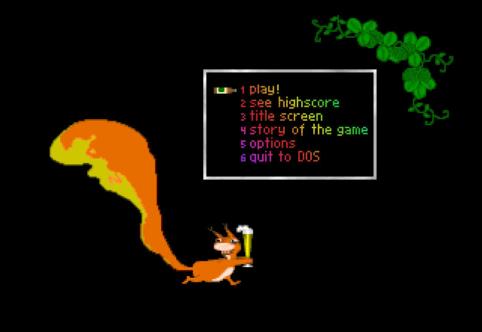
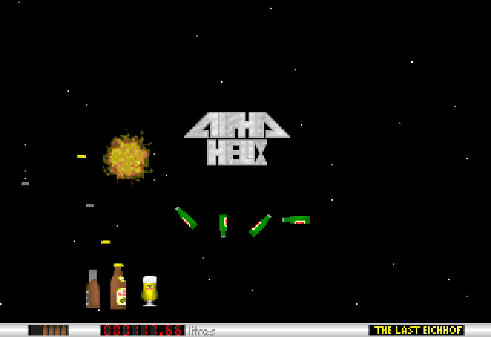
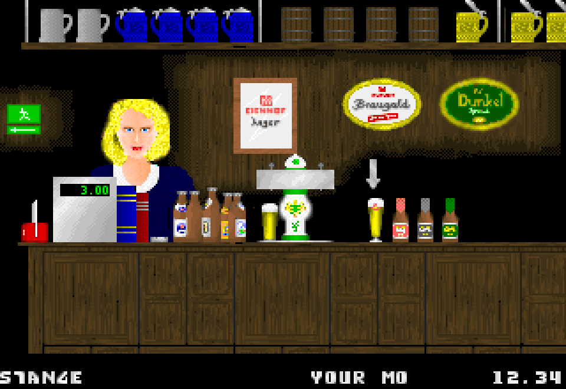

# The Last Eichhof — for today's computers, phones and browsers

A faithful port of **The Last Eichhof**, the 1993 freeware DOS shoot-'em-up by the Swiss group
**ALPHA-HELIX**: you fly the Eichhof beer bottle through five levels of enemies, and between levels
you spend your earnings on weapons at the bar. This port plays the original game's own pictures, sprites, fonts, sounds,
music and levels; only the program around them is new, rewritten in Rust so the game runs on
Windows, macOS, Linux, Android and in web browsers.

  
  
  

## The original game and its creators

*The Last Eichhof* — "An Alpha Helix Production, (c) copyright 1993" — was made by:

| | |
|---|---|
| **Tritone** | programming, sound effects and level design |
| **Tweety** | graphics and fonts |
| **Zynax** of Dark System | additional programming and music |

All the art, music, sound and level design you see and hear in this port is their work, used
unchanged. ALPHA-HELIX released the game as freeware and asked players to pass it on — the game says
*"This game is FREEWARE. Please copy like crazy. If you like it, just send a postcard to
ALPHA-HELIX"*, and its release notes end with *"PLEASE copy it to all your friends."* Thank you, Tritone, Tweety and Zynax. Ein Prosit auf
ALPHA-HELIX!

The full list of original files and what the port uses them for is in [CREDITS.md](CREDITS.md).

## Download and play

Download the zip for your system from the [Releases](../../releases) page, unpack it and start
`last-eichhof`. The original game data is built in, so nothing else is needed.

- **Windows, Linux:** start the program.
- **macOS:** the program isn't signed, so the first time right-click it and choose *Open*.
- **Web:** the page has to come from a web server (browsers don't load WebAssembly from a file),
  e.g. `python3 -m http.server` in the unpacked folder, then open `http://localhost:8000`.

## Playing

| Action | Keyboard | Touch screen |
|---|---|---|
| Move the bottle | arrow keys | drag on the right half of the screen (the bottle follows your finger's movement) |
| Fire | hold Space | touch and hold the left half |
| Pause | P | tap the top-right corner |
| Back / give up | Esc | tap the top-left corner |
| Menus | 1–6, or arrows + Space/Enter | swipe up/down, tap to choose |

Keys can be changed in *Options → Choose keys*, like in the original. Settings and high scores are
saved in the original `CONFIG.HIG` format (`~/.config/last-eichhof/` or `%APPDATA%\last-eichhof\`).
The original cheat still works: start the program with the argument `007.7`.

## How the port was made

The game rules were re-implemented by studying the original program (`BEER.EXE`, Borland C++,
16-bit DOS); every speed, price, hit point and timing taken from it is listed in
[MECHANICS.md](MECHANICS.md). The file formats inside `BEER.DAT` are described in
[docs/FORMATS.md](docs/FORMATS.md). New compared to the original: touch controls, window scaling,
and builds for modern systems.

## Building from source

Needs [Rust](https://rustup.rs). The original data in `data/` is built into the program.

- Desktop (Windows, macOS, Linux): `./build-desktop.sh` (or `cargo build --release`).
- Web: `./build-web.sh`, then serve the `web/` folder with any web server.
- Android: `./build-android.sh` (uses macroquad's build container through Docker).

Checks: `--screenshot <file.png>` saves a picture of the window after about 120 frames;
`--self-test <file.json>` plays the first level with scripted keys and reports whether moving,
shooting and the status bar work. `--scene <name>` (menu, store, menucard, sell, place, hs, title,
story, gameover, victory, intro:N, play:N:ticks) jumps to one screen.

`cargo build --release --no-default-features` makes a build without the built-in data; it looks for
`BEER.DAT` next to the program instead.

How releases are made: [RELEASING.md](RELEASING.md).

## Project files

| Path | What it is |
|---|---|
| `src/` | the Rust program (macroquad) |
| `data/` | the original game's `BEER.DAT`, `CONFIG.HIG` and `READ.ME`, unchanged |
| `MECHANICS.md` | every rule and number taken from the original program |
| `docs/FORMATS.md` | the original file formats |
| `tools/` | Python helpers used to study the data (`datdump.py`, `eich.py`, `contact.py`) |
| `web/` | the page and loader for the browser version |
| `PLAYERS.md` | the short guide included in each download as `README.txt` |

## Credits

*The Last Eichhof* © 1993 ALPHA-HELIX (Tritone, Tweety, Zynax of Dark System), freeware.
Port built with [macroquad](https://github.com/not-fl3/macroquad) (MIT/Apache-2.0).
Details in [CREDITS.md](CREDITS.md).

## License

The port's own code is released under the [MIT License](LICENSE). This does **not** cover the
original game's files in `data/`: *The Last Eichhof* and everything in `BEER.DAT` remain © 1993
ALPHA-HELIX, freeware, included unchanged as the authors invited ("Please copy like crazy").
